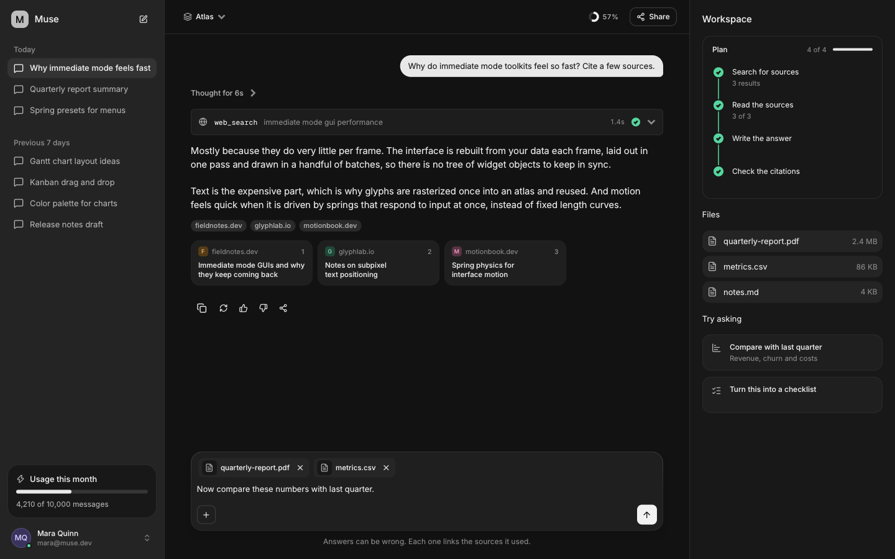
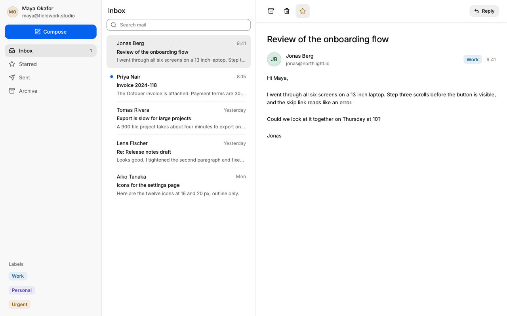
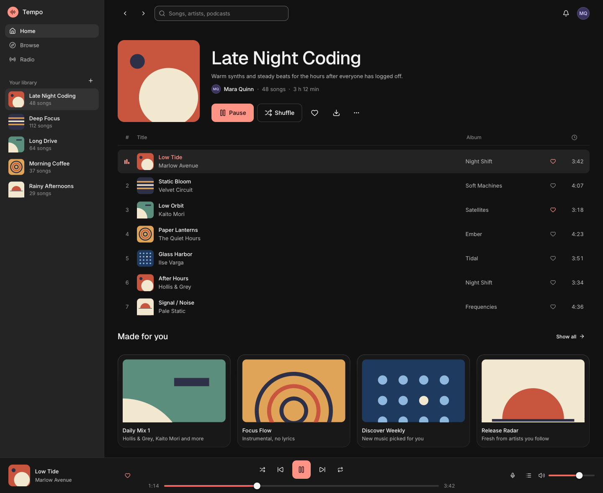
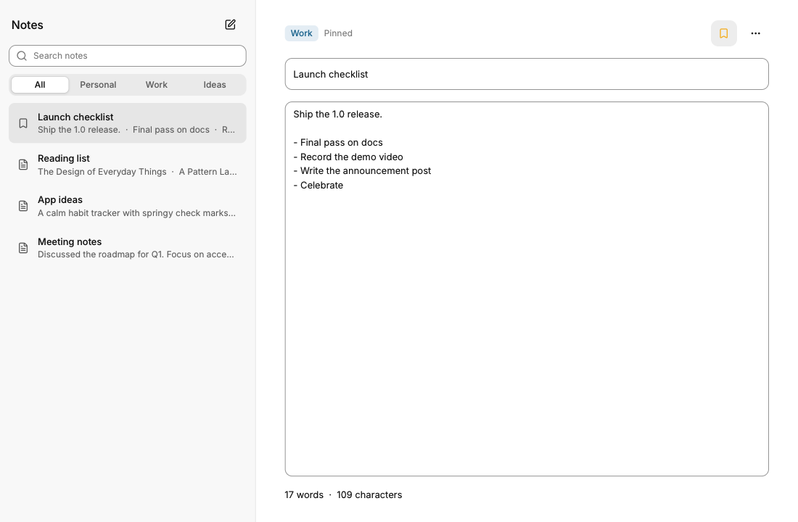
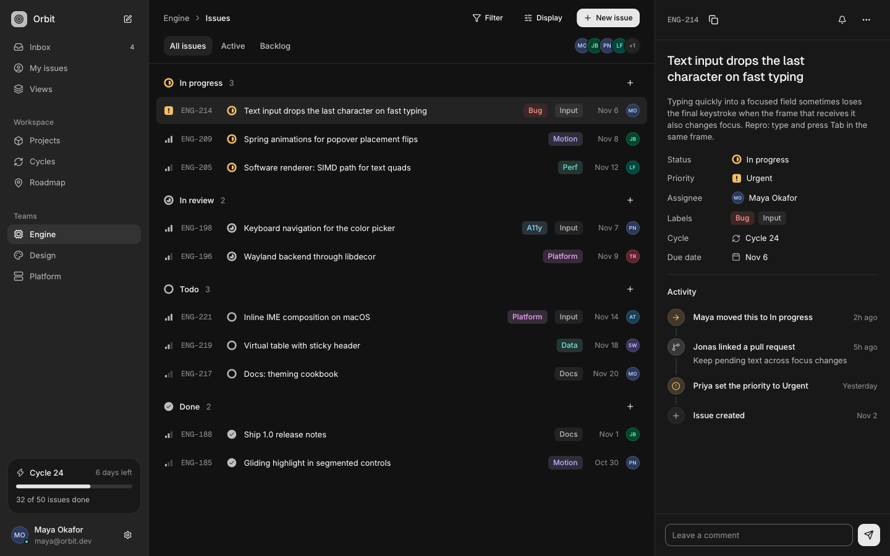
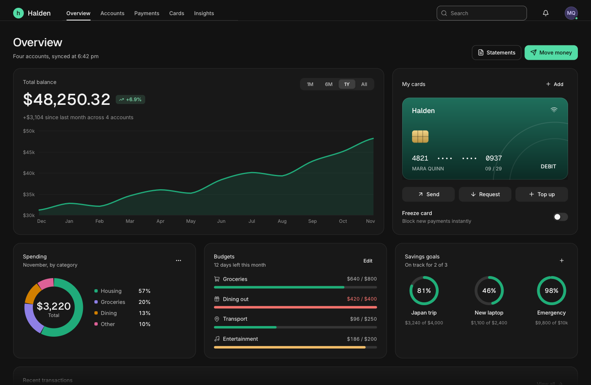
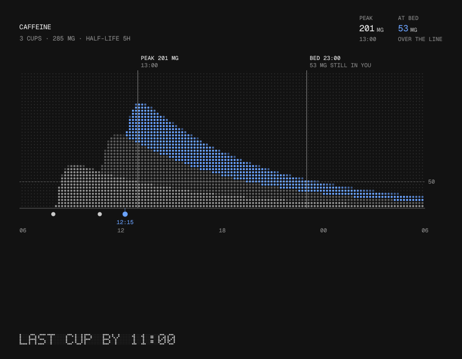
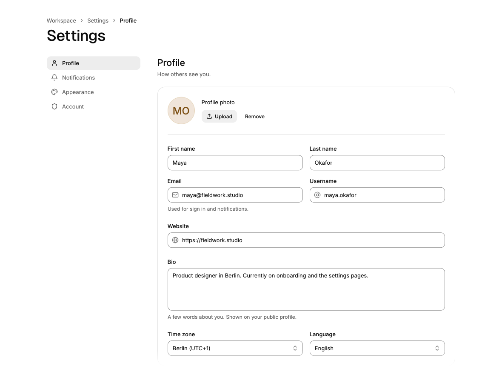
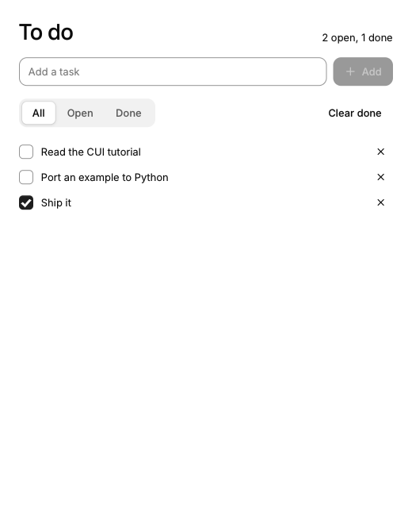

# PYCUI — CUI 的 Python 绑定

[CUI](https://github.com/yappologistic/CUI) 是一个用 C99 写的立即模式原生 UI 库（约 190 个组件，
自带软件渲染器与 Win32 / Cocoa / X11 / SDL2 / GLFW 窗口后端）。PYCUI 把它做成一个可以直接
`import cui` 的 Python 包：界面由 C 绘制，逻辑写在 Python 里。

```python
import cui

class State:
    def __init__(self):
        self.name = "Maya"
        self.notify = True

state = State()

def frame(ui: cui.UI) -> None:
    with ui.column(pad=24, gap=12):
        ui.heading("Hello, CUI")
        ui.text("The widgets are C; the logic is Python.")
        state.notify = ui.switch("Notifications", value=state.notify)
        state.name = ui.text_input("name", value=state.name, label="Name").text
        if ui.button("Save", variant=cui.ButtonVariant.PRIMARY, icon=cui.Icon.CHECK):
            ui.toast("Saved", tone=cui.Tone.SUCCESS)

cui.App().run(frame, title="Hello", width=900, height=600)
```

本机已编译通过并跑完测试。CUI 官方的示例应用已经移植到 `examples/` 下；每个示例既能开原生窗口，
也能加 `--shot` 用软件渲染离屏输出 PNG（不需要窗口、X server 或 GPU）：

```sh
python examples/todo.py                       # 原生窗口
python examples/todo.py --shot out.png        # 离屏渲染
python examples/dashboard.py --dark --shot dark.png
python examples/notes.py --frames 5 --shot notes.png
```

| 示例 | 内容 |
| --- | --- |
| `hello.py` | 最小的窗口、标题、开关和按钮 |
| `todo.py` | 待办列表：过滤、确认对话框、保存到文件 |
| `settings.py` | 设置页：侧栏、表单、外观与危险操作 |
| `notes.py` | 笔记：分栏、搜索、上下文菜单、命令面板 |
| `dashboard.py` | 仪表盘：折线图、环形图、表格、响应式侧栏 |
| `assistant.py` | 聊天助手：推理、工具调用、计划、来源与输入框 |
| `mail.py` | 三栏邮件：自绘列表行、分栏、对话框、抽屉 |
| `music.py` | 音乐播放器：自绘封面与均衡器、滑杆、菜单 |
| `tracker.py` | 议题跟踪：自绘状态图标、活动时间线、命令面板 |
| `finance.py` | 财务总览：余额图、卡片、环形图、预算与进度环 |
| `caffeine.py` | 咖啡因曲线：点阵图、标注、可拖动事件轨、点阵显示 |

CUI 的 `gallery`（组件总览）没有整体移植：它覆盖了大量仍在 Phase 3 的组件
（终端、文件浏览器、代码编辑器、树表等）；组件总览仍由 `examples/components.py`
提供。上面的 11 个应用示例是 `CUI/examples` 中除 `gallery` 外的全部应用。

<table>
<tr>
<td></td>
<td></td>
</tr>
<tr>
<td></td>
<td></td>
</tr>
<tr>
<td></td>
<td></td>
</tr>
<tr>
<td></td>
<td></td>
</tr>
<tr>
<td></td>
<td></td>
</tr>
</table>

离屏渲染的组件总览仍是 `examples/components.py`（浅色/深色截图见
`docs/images/components-light.png` 与 `components-dark.png`）：

```sh
python examples/components.py out.png          # 浅色
python examples/components.py out.png --dark   # 深色
```

## 安装

仓库里已经以 git submodule 形式带上 CUI 源码，构建时静态链接进扩展，所以轮子里没有
`libcui.dll`，也不存在 DLL 搜索路径问题。

```sh
python -m pip install cython scikit-build-core cmake    # 构建依赖
python -m pip install .                                  # 编译并安装
python -m pip install -e .                               # 开发模式（改 Python 不用重装）
```

构建需要一个 C 编译器：Windows 上装 Visual Studio（Desktop development with C++），
macOS 上 `xcode-select --install`，Linux 上 `build-essential` 加 `libx11-dev`。
扩展是按头文件在编译期对齐的：换 CUI 小版本必须重新编译，不要指望换 `.so`/`.pyd` 就能跑。

## 公开 API

| 层 | 说明 |
| --- | --- |
| `cui.UI` | 面向应用的 Pythonic 门面：`with ui.column()`、`ui.button(...)`、`ui.text_input(...)`；容器用 `with`，可能不显示的重叠层用回调（`ui.dialog(..., body=...)`）。 |
| `cui.App` | 原生窗口与事件循环；`App.run(frame)` 在 C 侧循环里释放 GIL，帧回调里的 Python 异常会被捕获、退出循环后再抛回。 |
| `cui.Context` / `cui.SoftwareRenderer` | 离屏渲染：`begin_frame()` / `end_frame()` / `draw_data()` / `screenshot(path)`，不需要窗口和 GPU。 |
| `cui._api` | 生成的低层封装：**一个 CUI 函数对应一个函数**，选项结构体变成关键字参数，出参变成返回值。`ui` 上找不到的方法会自动从这一层取。 |
| `cui.Color` / `cui.Size` / `cui.Date` / `cui.TextResult` | C 结构体对应的 Python 值类型。颜色可以用 `Color(255,0,0)`、`Color.rgb(0xE5484D)` 或 `Color.token(cui.Token.ACCENT)`。 |
| `cui.Series` / `cui.DotSeries` / `cui.ChartAnnotation` | 图表数据：折线/柱状序列、点阵图序列和图表标注；`CanvasResult`、`EventTrackResult` 是 canvas / 事件轨的返回值。 |
| 枚举与图标 | `cui.ButtonVariant`、`cui.Tone`、`cui.ThemeMode`、`cui.Icon.CHECK`、`cui.ICON_PLUS` 等，全部从 CUI 头文件生成。 |

立即模式的约定和 CUI 一样：每帧调用组件函数，函数返回这一帧发生了什么；你的变量就是状态。
字符串按 UTF-8 编码，含 NUL 或以 `None` 传给必填参数会直接抛异常（而不是让 C 侧读空指针）。

出参一律变成返回值，例如：

```python
on = ui.switch("Notifications", value=on)          # bool
index = ui.select("fruit", items, index=index)     # int
name = ui.text_input("name", value=name).text      # TextResult，跨帧保留编辑状态
```

## 代码结构

```text
src/cui/
  __init__.py        公开命名空间（枚举、图标、App/UI/Context/数值类型）
  ui.py              Pythonic 门面（容器、约 60 个常用组件、回调式重叠层）
  _types.py          Color / Size / Date / TextResult / TextMetrics
  _cui.pyx           手写 Cython 核心：上下文与 App 生命周期、GIL、字符串保活、软件渲染
  _cui.pxd           核心对象的 C 侧声明，供生成的封装层直接调用
  _trampoline.c      cui_app_run 的帧回调 trampoline（进 Python 前重新拿 GIL）
  cui_decl.pxd       生成：C 结构体 / 枚举 / 函数声明
  _api.pyx           生成：每个可调用 CUI 函数一个封装
  _gen/constants.py  生成：枚举、整数常量、图标字符串
  _gen/model.py      生成：CUI 数据结构的 NamedTuple
  _gen/sizes.h       生成：不透明句柄的 sizeof 与个别字段的 setter
  _gen/COVERAGE.md   生成：哪些函数已封装、哪些留到下一阶段
tools/gen_cui.py     生成器（libclang 解析 cui.h / cui_render.h / cui_app.h）
tests/               pytest：转换、生命周期、离屏渲染、门面覆盖、生成物同步
examples/            移植自 CUI/examples 的示例应用 + 共享的 _common.py 运行器
```

映射规则（由 `tools/gen_cui.py` 实现）：

| C 形态 | Python |
| --- | --- |
| `const T *_opts` | 关键字参数；零值就是 CUI 的默认值 |
| `bool *` / `int *` / `float *` / `double *` 等出参 | 多一个返回值 |
| `char *buf, size_t cap` | `text=` 传进去，返回 `TextResult`；缓冲区按 id 跨帧保留 |
| `const char *const *items, int count` | `Sequence[str]` |
| `const float *values, int count` | `Sequence[float]` |
| `const T *items, int count`（T 是纯数据） | `Sequence[cui.T]`，自动打包成 C 数组 |
| `T *`（不透明句柄） | `cui.T()` 句柄对象，Python 侧持有并清零 |
| 返回 `cui_color` / `cui_size` / `cui_date` 等 | 对应的 Python 值类型 |

## 生成器

```sh
python tools/gen_cui.py           # 重新生成 src/cui 下的生成物
python tools/gen_cui.py --check   # CI：生成物与头文件不同步就以非 0 退出
```

`--check` 是升级 CUI 时的安全网：头文件新增函数、改结构体布局而没重新生成，CI 会失败。
生成物已提交到仓库，所以 `pip install` 不需要 libclang。

## 测试

```sh
python -m pytest tests -q
$env:PYCUI_WINDOW_TESTS = "1"; python -m pytest tests -q   # 额外跑原生窗口测试
```

默认测试全部离屏（`cui_sw_*` 软件渲染），不需要窗口、X server 或 GPU，CI 上稳定。
`tests/test_examples.py` 会把 `examples/` 里的每个应用按 `--shot` 渲染一遍，检查它们没有
异常且确实写出了 PNG；`tests/test_charts.py` 覆盖 canvas 回调、图表和事件轨。
窗口测试需要一个可交互的桌面会话，因此用环境变量显式开启。

## 当前范围与已知限制

- CUI 的 500 个公开函数里，**429 个已经封装**（369 个由生成器封装，60 个在 `_cui.pyx` 手写，
  包括 canvas 绘制回调、折线/柱状/点阵图、事件轨、分栏等），其余 71 个在
  `src/cui/_gen/COVERAGE.md` 里逐条列了原因：
  需要 C 回调（`cui_tree_sort`、`cui_state_on_free` 等）、变参（`cui_textf` 等）、
  调用方分配的结构体数组（日志/终端/差异视图/树表等数据密集组件）、返回结构体的组件，
  以及 GL 渲染器接口。这些是计划里的 Phase 3 内容。
- 没有内置无障碍与输入法支持：CUI 本身没有，绑定只能继承这个限制。
- 一个 `cui.Context` 只能在一个线程里用（macOS 上还必须是主线程），越界会抛 `RuntimeError`。
- CUI 的事件循环是事件驱动的：静态画面会睡到下一个输入事件。需要定时刷新时在帧回调里调用
  `ctx.request_wakeup(seconds)`（示例见 `tests/test_app.py`）。
- 平台：本机（Windows 11 + MSVC 19.52 + Python 3.14）已编译并测试通过；macOS / Linux 需要
  对应的 CUI 后端依赖（Cocoa / X11），构建脚本已按 CUI 的 CMake 选项接好。

## 许可

绑定代码 MIT。CUI 也是 MIT，字体与图标许可见 `CUI/THIRD_PARTY.md` 与 `CUI/LICENSE`。
